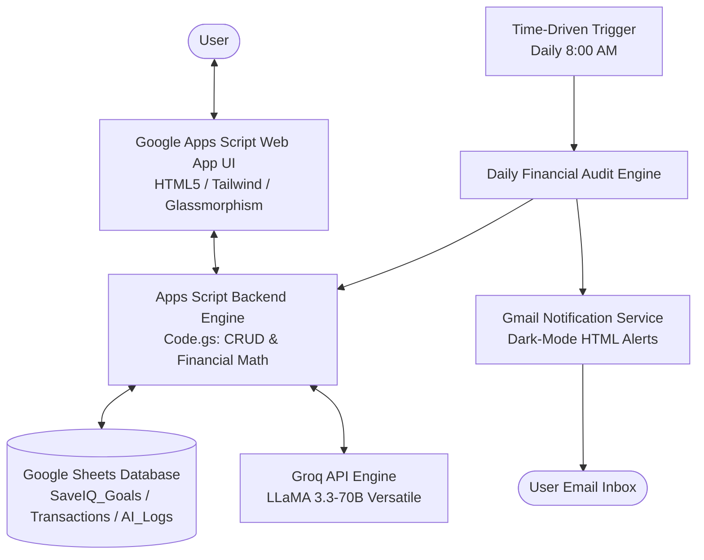
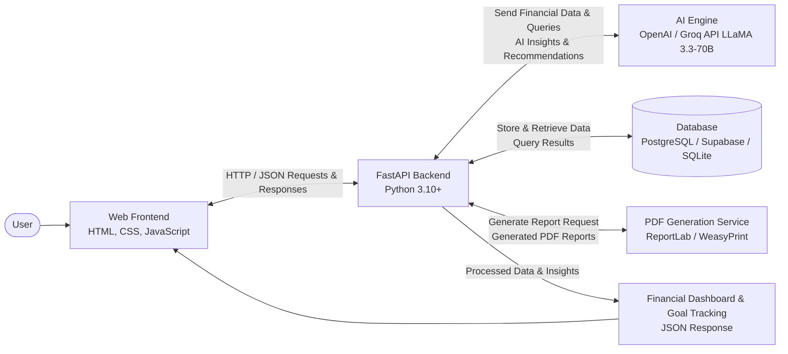

# SaveIQ – AI Savings Goal Tracker
## Comprehensive System Architecture & Engineering Specification

SaveIQ is an AI-powered personal finance management and savings tracking platform designed to help users define financial goals, monitor savings velocity, and achieve financial freedom through intelligent recommendations and proactive automation.

The platform provides dual-architecture deployment:
1. **Serverless Google Workspace Stack**: Google Apps Script + Google Sheets + Groq AI (LLaMA 3.3-70B) + Gmail Services + HTML/JS Web App.
2. **Production Microservices Stack**: FastAPI Backend + PostgreSQL / Supabase / SQLite + Groq API + ReportLab PDF Services + Modern Glassmorphism Web App (matches the uploaded architecture diagram).

---

## 🏛️ System Architecture

### Architecture Option A: Google Workspace Cloud Native (Serverless)



### Architecture Option B: FastAPI + Database + AI Engine + PDF Service (Matches Architecture Diagram)



---

## 💾 Database Schema & Data Dictionaries

### 1. Goals Table (`SaveIQ_Goals` / `goals`)

| Field | Type | Description |
| :--- | :--- | :--- |
| `goal_id` | String (PK) | Unique goal identifier (e.g. `GOAL-1001`) |
| `user_email` | String | User's email for automated alerts |
| `goal_name` | String | Name of savings goal (e.g., "Emergency Reserve") |
| `category` | String | Categorization (Emergency, Travel, Gadget, Education, etc.) |
| `target_amount` | Float | Target financial amount in USD |
| `current_savings` | Float | Accumulated savings balance |
| `remaining_amount` | Float | `target_amount - current_savings` |
| `deadline` | Date / String | Target completion date (YYYY-MM-DD) |
| `days_remaining` | Integer | Calculated days until deadline |
| `progress_pct` | Float | `(current_savings / target_amount) * 100` |
| `status` | String | `In Progress`, `Completed`, `Near Deadline`, `Overdue` |
| `email_alerts_enabled` | Boolean | Opt-in flag for daily audit reminders |
| `purpose` | Text | Personal rationale and motivational context |
| `last_alert_sent` | Timestamp | Date of last dispatched email alert |
| `created_at` | Timestamp | Goal creation timestamp |
| `updated_at` | Timestamp | Last balance or detail update timestamp |

### 2. Transactions Table (`SaveIQ_Transactions` / `transactions`)

| Field | Type | Description |
| :--- | :--- | :--- |
| `transaction_id` | String (PK) | Unique transaction record ID (e.g. `TX-100234`) |
| `goal_id` | String (FK) | Reference to target savings goal |
| `date` | Timestamp | Timestamp of deposit |
| `amount` | Float | Deposit value |
| `note` | String | Allocation note (e.g. "Payday automatic transfer") |
| `previous_balance`| Float | Balance before deposit |
| `new_balance` | Float | Balance after deposit |

### 3. AI Insights Log Table (`SaveIQ_AI_Logs` / `ai_logs`)

| Field | Type | Description |
| :--- | :--- | :--- |
| `log_id` | String (PK) | Unique AI audit log ID |
| `goal_id` | String (FK) | Reference to target savings goal |
| `timestamp` | Timestamp | Invocation time |
| `prompt` | Text | Prompt context and metrics provided to model |
| `recommendation` | Text | Full markdown guidance returned by Groq LLaMA 3.3-70B |
| `model` | String | Model used (`llama-3.3-70b-versatile`) |

---

## 🧠 Groq AI & Financial Recommendation Engine

SaveIQ incorporates behavioral economics frameworks into its prompt engineering:

### Mathematical Velocity Formulations
$$\text{Days Remaining} = \text{Deadline Date} - \text{Current Date}$$
$$\text{Remaining Balance} = \max(0, \text{Target Amount} - \text{Current Savings})$$
$$\text{Daily Required Pace} = \frac{\text{Remaining Balance}}{\max(1, \text{Days Remaining})}$$
$$\text{Weekly Required Pace} = \frac{\text{Remaining Balance}}{\max(1, \lceil \text{Days Remaining} / 7 \rceil)}$$

### Behavioral Principles Enforced
1. **The 72-Hour Rule**: Users are instructed to delay non-essential purchases matching their daily pace by 72 hours.
2. **Payday Habit Stacking**: Automating deposits immediately upon income arrival to eliminate decision fatigue.
3. **The 50/30/20 Micro-Trim**: Shaving 5% from discretionary variable spending directly into lagging goals.

---

## ⏱️ Daily Audit Engine & Gmail Notification Logic

The automated audit engine runs on a time-driven trigger daily:

```
For each Goal:
  1. Recalculate days_remaining and progress_pct.
  2. Update status:
     - If progress_pct >= 100% -> 'Completed'
     - Else if days_remaining < 0 -> 'Overdue'
     - Else if days_remaining <= 14 -> 'Near Deadline'
     - Else -> 'In Progress'
  3. Check Alert Criteria:
     - email_alerts_enabled is TRUE
     - status != 'Completed'
     - (status == 'Overdue' OR status == 'Near Deadline' OR (days_remaining <= 30 AND progress_pct < 40%))
     - last_alert_sent != today
  4. If criteria met:
     - Generate stylized HTML email with progress bar, pacing breakdown, and AI tips.
     - Dispatch via MailApp.sendEmail / GmailApp.
     - Update last_alert_sent timestamp.
```

---

## 📂 Repository Structure

```
saveiq/
├── ARCHITECTURE.md                  # This document
├── google-apps-script/
│   ├── Code.gs                      # Google Apps Script core engine (CRUD, Sheets, Groq AI, Gmail)
│   ├── Index.html                   # Responsive Web App UI for Google Workspace deployment
│   ├── appsscript.json              # Apps Script manifest and OAuth scopes
│   └── README.md                    # 5-minute Google Workspace deployment guide
├── fastapi-backend/
│   ├── main.py                      # FastAPI application & REST routing
│   ├── database.py                  # Database connection (SQLite / PostgreSQL / Supabase)
│   ├── models.py                    # SQLAlchemy ORM models & Pydantic schemas
│   ├── ai_engine.py                 # Groq API LLaMA 3.3-70B integration & CFP heuristics
│   ├── pdf_service.py               # ReportLab PDF statement generation service
│   ├── requirements.txt             # Python dependencies
│   ├── .env.example                 # Environment configuration template
│   └── README.md                    # FastAPI setup and execution guide
└── web-frontend/
    ├── index.html                   # Modern glassmorphism UI with analytics & modals
    ├── styles.css                   # Custom responsive styling and theme tokens
    └── app.js                       # Frontend state engine, Groq caller, PDF printer & charts
```
